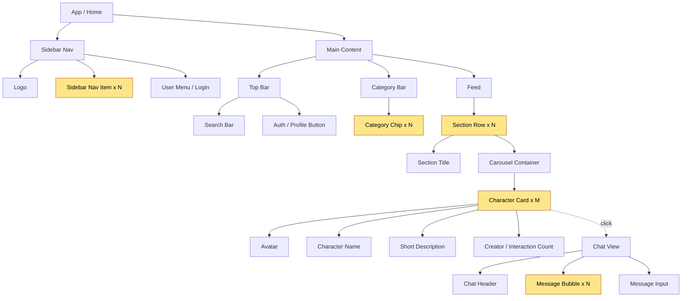

# Análisis de estructura: Character.AI

> Análisis de los bloques repetidos (ciclos) y del árbol de componentes de la página principal de **https://character.ai/**.

---

## 📌 Tabla de contenidos

1. [Página analizada](#-página-analizada)
2. [Nota de metodología y limitaciones](#-nota-de-metodología-y-limitaciones)
3. [Cajas que se repiten (ciclos)](#-cajas-que-se-repiten-ciclos)
4. [Propiedad principal de cada caja](#-propiedad-principal-de-cada-caja)
5. [Árbol de componentes (Mermaid)](#-árbol-de-componentes-mermaid)
6. [Cómo verificar y completar el análisis](#-cómo-verificar-y-completar-el-análisis)

---

## 🌐 Página analizada

| Campo | Detalle |
|---|---|
| **URL** | https://character.ai/ |
| **Sitio** | Character.AI (Character Technologies Inc.) |
| **Tipo de página** | Home / Discover (feed de descubrimiento) |
| **Propósito** | Plataforma para conversar con personajes de IA (ficticios, famosos, asistentes o creados por usuarios) |
| **Patrón de UI dominante** | Feed de tarjetas organizado por categorías y filas/carruseles |

---

## ⚠️ Nota de metodología y limitaciones

El sitio **bloqueó la lectura automática** (detección de bots), por lo que **no se pudo inspeccionar el HTML/DOM real**. Este análisis se construyó a partir de fuentes públicas secundarias (reseñas, guías de uso y análisis de UX de la home).

- Lo que aparece como **hecho** está respaldado por esas fuentes (feed de personajes, categorías, buscador, tarjetas de personaje).
- Lo marcado como **(inferido)** es una deducción razonable del patrón de UI y **debe validarse** con las DevTools del navegador (ver la última sección).
- Los nombres de componentes son **nombres lógicos propuestos**, no las clases CSS reales del sitio.
- La interfaz cambia con frecuencia; el diseño actual puede diferir ligeramente.

---

## 🔁 Cajas que se repiten (ciclos)

| # | Caja repetida | Dónde se repite | Cantidad típica |
|---|---|---|---|
| 1 | **Character Card** (tarjeta de personaje) | Dentro de cada fila/carrusel y en resultados de búsqueda | Decenas por pantalla |
| 2 | **Category Chip / Tab** (pestaña de categoría) | Barra de categorías (p. ej. recomendados, famosos, juegos, anime, películas y TV, aprendizaje de idiomas, comedia, etc.) | Una por categoría |
| 3 | **Section Row / Carousel** (fila temática) | Lista vertical de secciones del feed | Varias filas apiladas |
| 4 | **Sidebar Nav Item** *(inferido)* | Menú lateral/inferior de navegación (Inicio, Crear, Chats, etc.) | Pocos ítems |
| 5 | **Message Bubble** | Solo en la vista de chat (no en la home) | Una por mensaje |

### Jerarquía de los ciclos

```
Feed
 └── Section Row        ← ciclo nivel 1 (se repite por sección)
      └── Character Card ← ciclo nivel 2 (se repite dentro de cada fila)
```

Es un **ciclo anidado**: *N* filas × *M* tarjetas por fila.

---

## 🎯 Propiedad principal de cada caja

| Caja | Propiedad principal | Para qué sirve |
|---|---|---|
| **Character Card** | Identidad del personaje: **avatar + nombre + descripción corta** (más autor/contador de interacciones *(inferido)*) | Es el punto de entrada: al hacer clic abre el chat con ese personaje |
| **Category Chip / Tab** | **Filtro por categoría** (etiqueta de texto) | Cambia el conjunto de personajes mostrados |
| **Section Row / Carousel** | **Agrupación temática con scroll horizontal** (título + lista de tarjetas) | Organiza el contenido por tema o curación |
| **Sidebar Nav Item** | **Destino de navegación** (ícono + etiqueta) | Mover al usuario entre las áreas principales |
| **Message Bubble** | **Emisor + texto** (usuario vs. personaje) | Representar la conversación |
| **Search Bar** *(no se repite)* | **Búsqueda por nombre o franquicia** | Encontrar personajes específicos |

---

## 🌳 Árbol de componentes (Mermaid)



> 🟨 Los nodos en amarillo son los **componentes que se repiten (ciclos)**.

---

## 🔍 Cómo verificar y completar el análisis

Para convertir lo inferido en datos exactos:

1. Abre https://character.ai/ en tu navegador.
2. Haz clic derecho sobre una tarjeta de personaje → **Inspeccionar**.
3. Sube por el DOM hasta encontrar el **contenedor padre que contiene hijos con la misma estructura**: ese es el ciclo.
4. Anota:
   - La etiqueta/clase del contenedor repetido.
   - Los hijos fijos (imagen, título, texto).
   - El atributo que enlaza al chat (normalmente un `href` con el ID del personaje).
5. Repite con las pestañas de categoría y con las filas del feed.
6. Sustituye en este README los nombres lógicos por los reales.

---

## 📄 Licencia

Documento de análisis con fines educativos. Character.AI y sus marcas pertenecen a sus respectivos propietarios; este repositorio no está afiliado a ellos.